# رهنمای استفاده — سیستم مدیریت کابل کارگو

دو نوع کاربر داریم:

- **مدیر بندر** — کارهای روزانهٔ یک بندر: نرخ روز، معاملات، اسناد، حواله، مصارف دفتر، گزارش.
- **سوپر ادمین** (دفتر کابل) — همهٔ کارهای بالا برای همهٔ بندرها، به‌علاوهٔ بندرها، کاربران و نرخ‌ها.

چند قاعدهٔ عمومی:

- اعداد را هم با ارقام دری (۱۲۳) و هم انگلیسی (123) می‌توانید بنویسید.
- تاریخ همه‌جا شمسی است و میلادی هم زیرش دیده می‌شود.
- مبلغ‌ها همه‌جا به افغانی و دالر نشان داده می‌شوند (با نرخ همان روز).
- **عاید = «پرداخت مشتری» و هر نوعی که سوپر ادمین «عاید» تعیین کرده.** بقیه (خاک‌پولی، تعرفه، ترانسپورت،
  بندر والی …) مصرف‌اند. بیلانس = جملهٔ عواید − جملهٔ مصارف. فورم معامله دو بخش دارد: «عواید» و «مصارف».
- زبان (دری / پښتو / English) و حالت تاریک از بالای صفحه عوض می‌شود.

---

# بخش اول — مدیر بندر

## ۱. ورود

نشانی سیستم را باز کنید (مثلاً `https://transit.kabulcargo.com`)، نام کاربری و رمز را بنویسید و
**ورود** را بزنید.

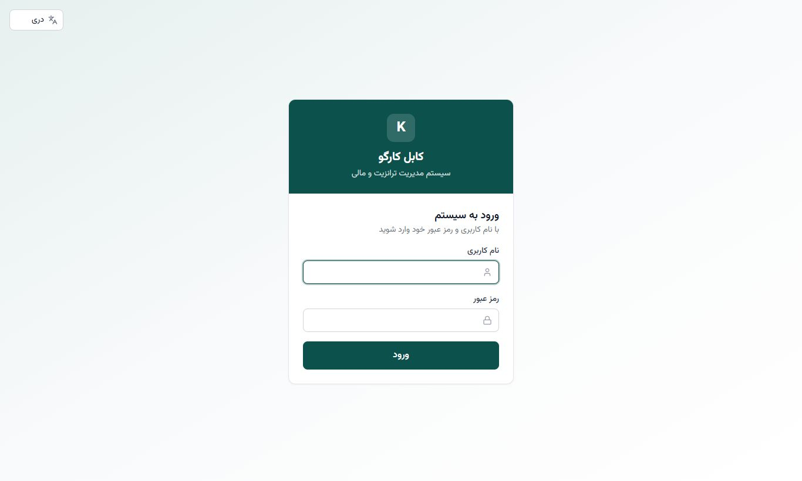

- بعد از ۵ رمز اشتباه، حساب ۱۵ دقیقه قفل می‌شود. برای باز شدن زودتر به سوپر ادمین زنگ بزنید.
- رمز خود را به کسی ندهید. اگر فراموش کردید، سوپر ادمین رمز تازه می‌گذارد.

## ۲. نرخ روز (هر صبح)

تا نرخ دالرِ امروز ثبت نشود، ثبت معامله، حواله و مصرف دفتر ممکن نیست. داشبورد آن را با رنگ
سرخ نشان می‌دهد:

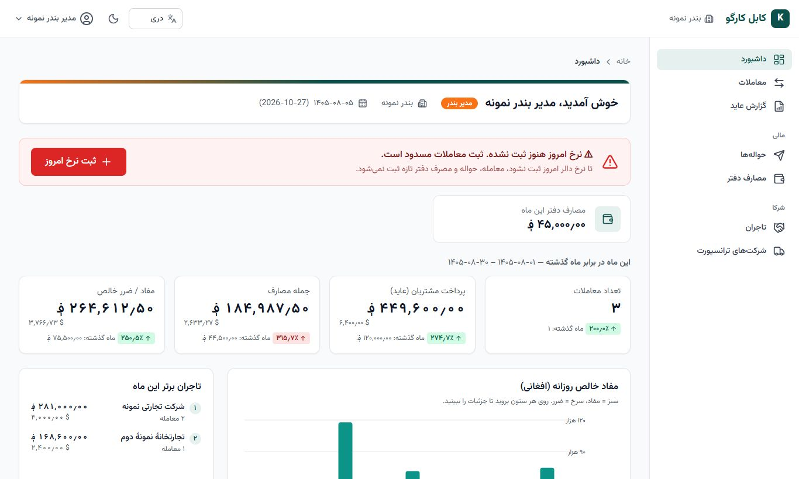

در صفحهٔ **معاملات** روی **ثبت نرخ امروز** بزنید (یا فقط معامله ثبت کنید؛ سیستم خودش همین پنجره را
باز می‌کند). نرخ را بنویسید و **ذخیره** کنید.

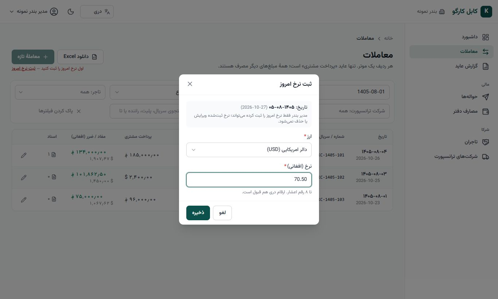

- شما فقط نرخ **امروز** را ثبت می‌کنید. اگر اشتباه نوشتید، به سوپر ادمین بگویید تا اصلاح کند.
- نرخ هر معامله جدا ذخیره می‌شود؛ تغییر نرخ فردا معاملات امروز را عوض نمی‌کند.

## ۳. داشبورد

ارقام همین ماه در برابر ماه گذشته: تعداد معاملات، پرداخت مشتریان (عاید)، جملهٔ مصارف و مفاد /
ضرر خالص؛ نمودار مفاد روزانه (سبز = مفاد، سرخ = ضرر)؛ تاجران برتر و آخرین معاملات.

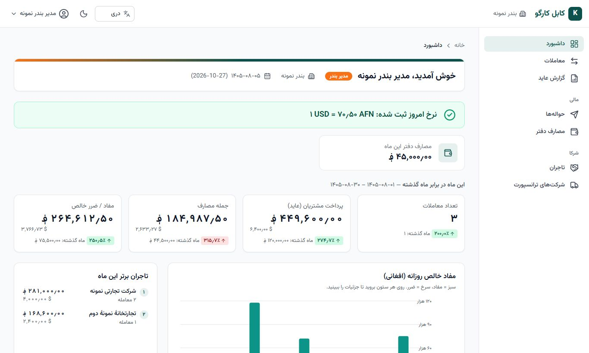

## ۴. معاملهٔ تازه

1. **معاملات → معاملهٔ تازه** و نوع معامله را انتخاب کنید: صادرات، واردات، ترانزیت یا تیر کارنت.

   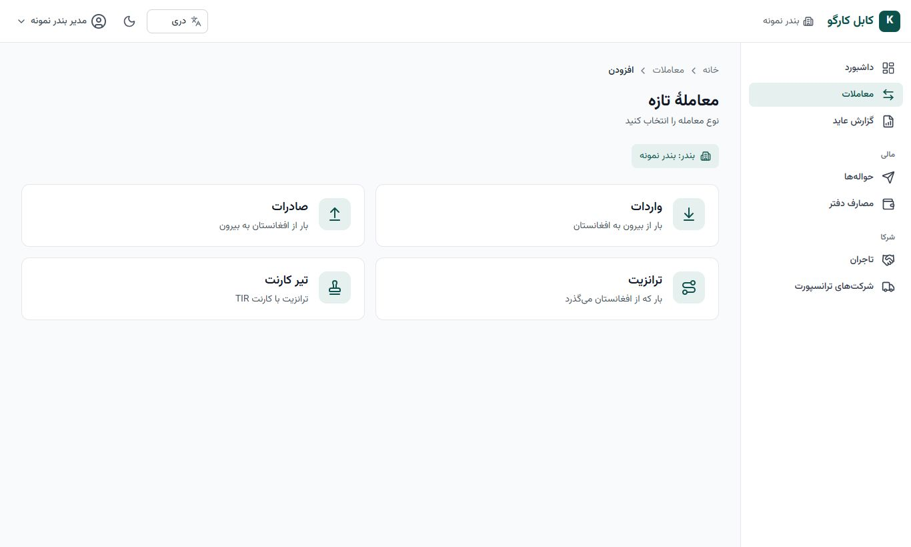

2. فورم را پر کنید. فیلدهای ستاره‌دار (*) لازم‌اند. بخش‌ها: شناسه، اطراف (تاجر، راننده، شرکت
   ترانسپورت)، موتر و بار، اسناد و گمرک، عاید و ارز، مصارف، ملاحظات.
   - تاجر یا شرکت تازه را می‌توانید همان‌جا از لیست، با «افزودن» بسازید.
   - **خلاصهٔ ردیف** (کنار فورم) همزمان عاید، مصارف و بیلانس را نشان می‌دهد.
3. **ذخیره** را بزنید.

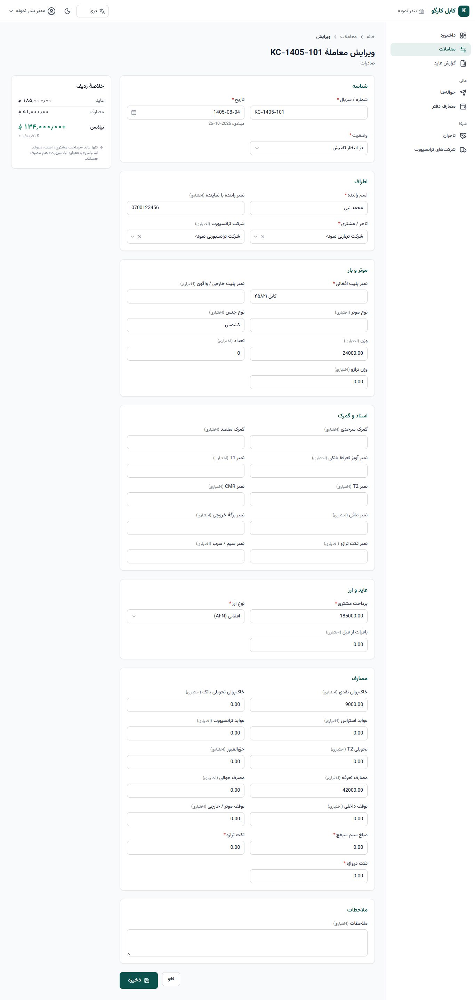

فهرست معاملات را با تاریخ، نوع، تاجر، شرکت ترانسپورت، «سند دارد / ندارد» و جستجو (سریال، پلیت،
راننده) فیلتر کنید. روی هر ردیف بزنید تا جزئیات باز شود.

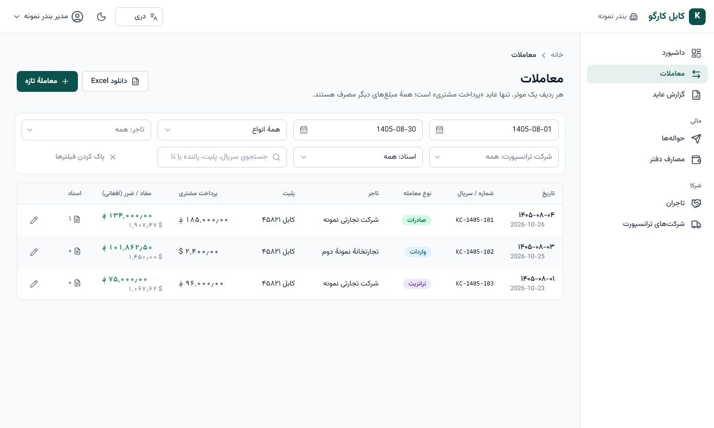

## ۵. اسناد (بارنامه، T1، عکس پلیت …)

در صفحهٔ جزئیات معامله، پایین صفحه بخش **اسناد**: فایل را بکشید و رها کنید یا **انتخاب فایل**
را بزنید (PDF، JPG، PNG، WEBP — هر فایل حداکثر ۱۰ میگابایت). برای دیدن یا دانلود، روی سند بزنید.

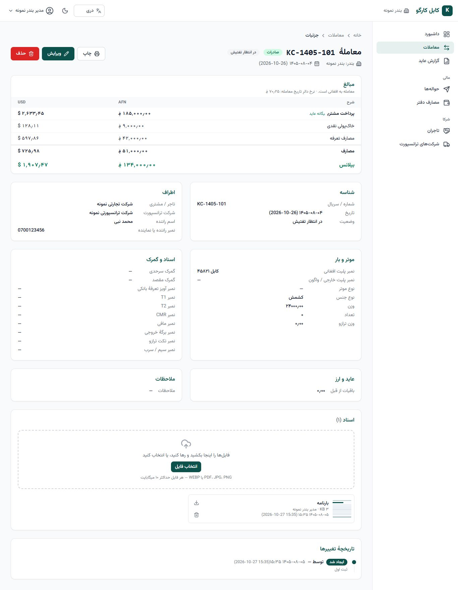

- **چاپ** یک صفحهٔ مرتب برای امضا می‌سازد. **ویرایش** و **حذف** هم بالای همین صفحه‌اند.
- **تاریخچهٔ تغییرها** نشان می‌دهد چه کسی، چه وقت، کدام مبلغ را عوض کرده.
- اسناد فقط برای کاربران همان بندر (و سوپر ادمین) باز می‌شوند.

## ۶. حواله‌ها

**مالی → حواله‌ها**: هر پولی که با حواله فرستاده یا گرفته می‌شود. فقط **مصرف حواله** (کمیشن)
مصرف حساب می‌شود؛ خود مبلغ انتقالی عاید یا مصرف نیست.

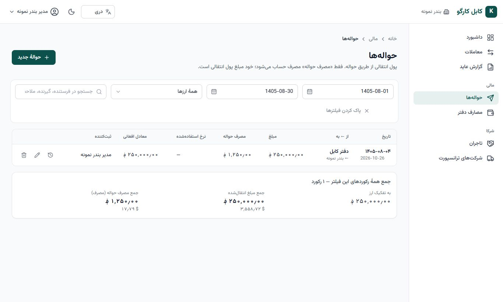

دکمهٔ افزودن → تاریخ، فرستنده، گیرنده، مبلغ، ارز، مصرف حواله → **ذخیره**. نرخ همان روز خودکار
ذخیره می‌شود.

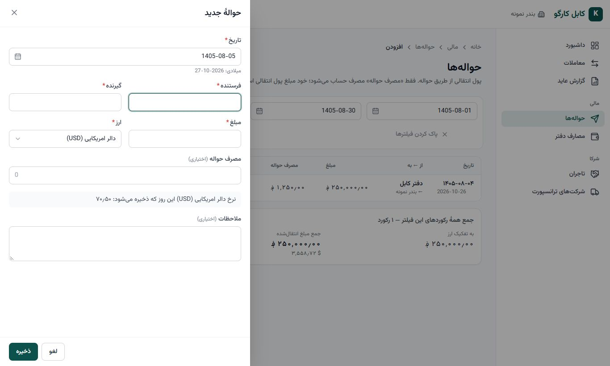

## ۷. مصارف دفتر

**مالی → مصارف دفتر**: کرایه، معاش کارمندان، تیل، برق و … . بالای صفحه جمع هر نوع، و پایین
جمع همهٔ رکوردهای فیلتر به افغانی و دالر دیده می‌شود.

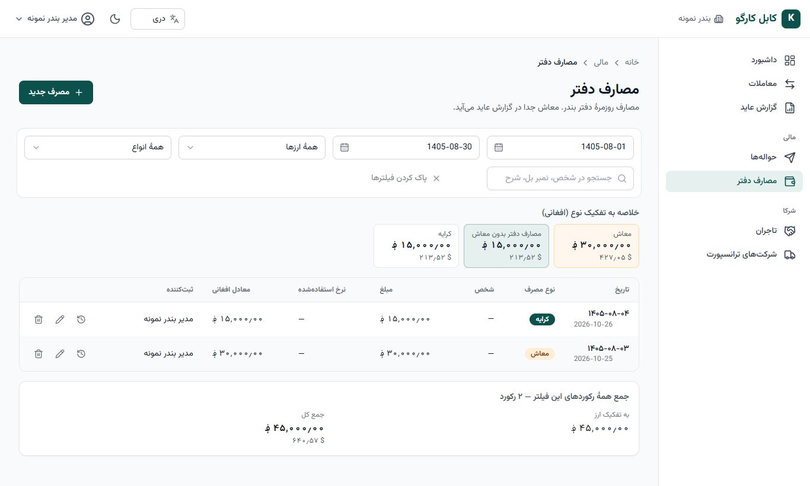

### عواید دفتر

**مالی → عواید دفتر**: پولی که خود دفتر بندر می‌گیرد و به یک موتر وصل نیست (کمیشن، خدمات اسناد،
کرایهٔ گدام …). مثل مصارف دفتر ثبت می‌شود: تاریخ، کتگوری، مبلغ، ارز. نرخ همان روز خودکار ذخیره
می‌شود. در گزارش عاید زیر **«سایر عواید»** و در داشبورد در کاشی **«عواید دفتر این ماه»** می‌آید.

## ۸. گزارش عاید

**گزارش عاید**: صورت حساب عاید و مصارف (به شکل IAS 1) — عاید، هزینهٔ مستقیم، مفاد ناخالص، مصارف
عملیاتی و **مفاد / ضرر خالص**. دوره: این ماه، ماه گذشته، این ربع، امسال یا بازهٔ دلخواه.

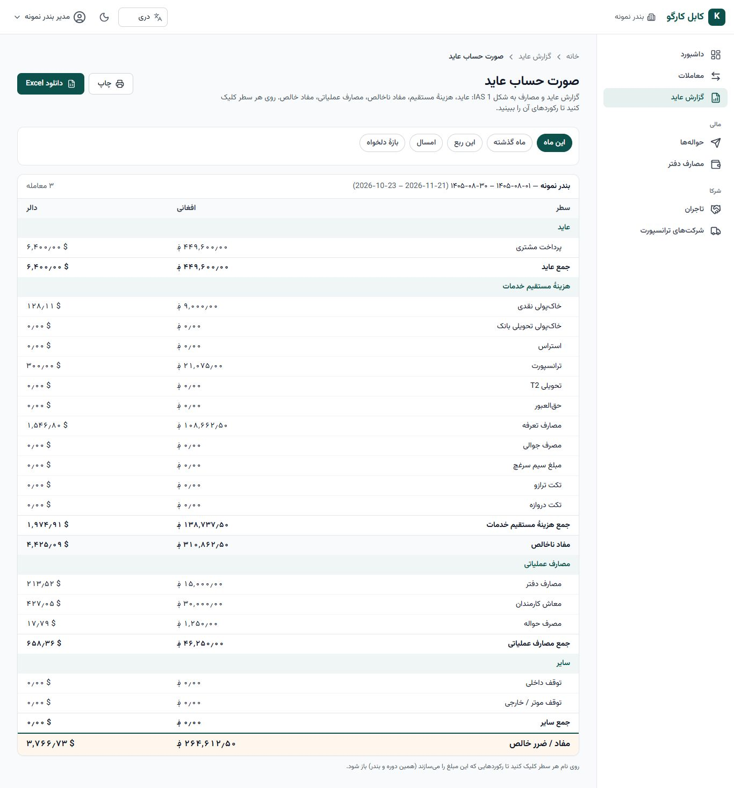

- روی نام هر سطر بزنید تا معاملات یا مصارفی که آن مبلغ را ساخته‌اند ببینید.
- ضرر به رنگ سرخ و در قوس () نشان داده می‌شود.
- **چاپ** برای نسخهٔ کاغذی.

## ۹. خروجی Excel

- **گزارش عاید → دانلود Excel**: همان گزارش در یک فایل Excel (راست‌به‌چپ، اعداد واقعی که می‌توانید
  جمع بزنید).
- **معاملات → دانلود Excel**: همهٔ معاملاتی که با فیلترهای فعلی دیده می‌شوند (نه فقط یک صفحه)، با
  ردیف جمع.

---

# بخش دوم — سوپر ادمین

سوپر ادمین همهٔ صفحه‌های بخش اول را برای **همهٔ بندرها** می‌بیند (در هر صفحه فیلتر بندر هست) و
بخش **مدیریت** را هم دارد.

## ۱. داشبورد

مثل مدیر بندر، به‌علاوهٔ: تعداد بندرها، کاربران، نرخ امروز، و **مقایسهٔ بندرها** در این ماه
(روی عنوان هر ستون بزنید تا مرتب شود). از لیست بالای صفحه یک بندر را انتخاب کنید تا داشبورد
همان بندر را ببینید.

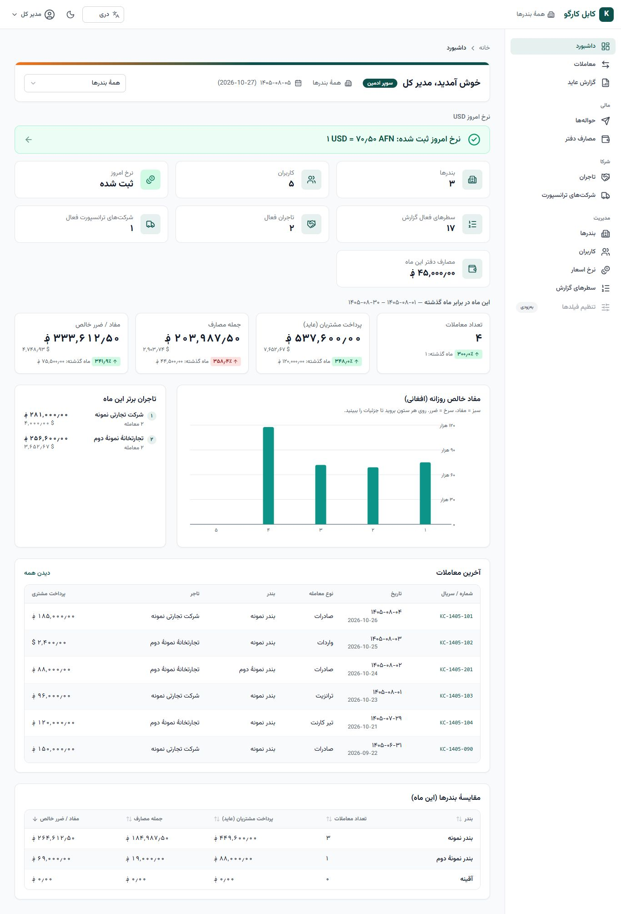

## ۲. بندرها

**مدیریت → بندرها → بندر تازه**: نام، کود کوتاه انگلیسی (مثلاً `HRT`)، شهر، تلفن.

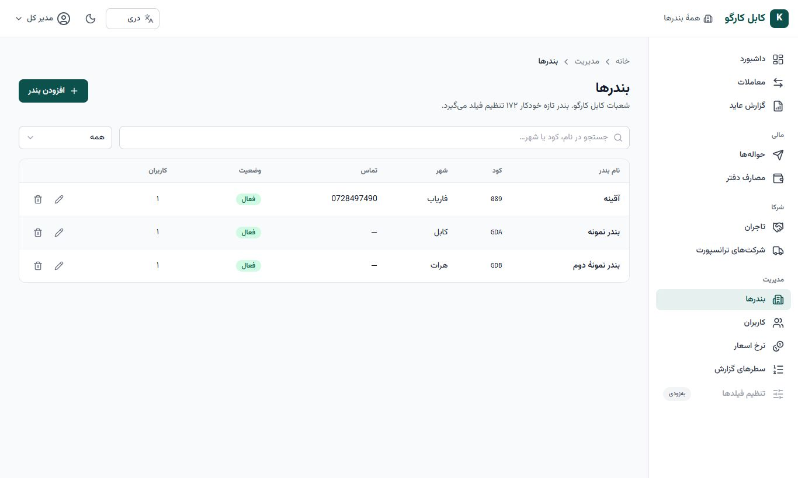
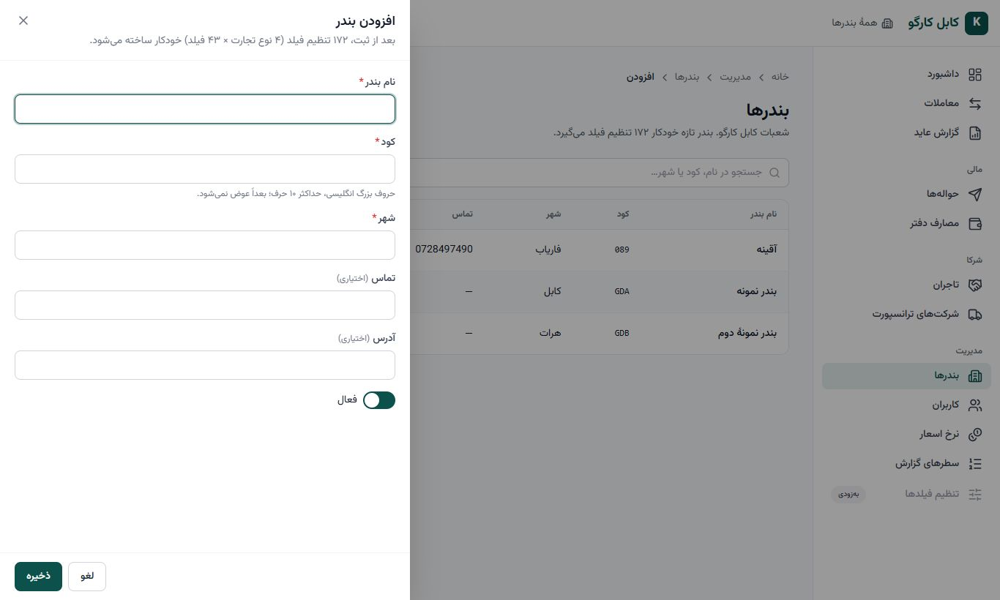

- **کود بندر بعد از ثبت عوض نمی‌شود** (در گزارش‌ها و بک‌اپ به آن اشاره می‌شود). نام را هر وقت
  می‌توانید عوض کنید.
- بندری که کاربر یا معامله دارد حذف نمی‌شود؛ به‌جایش آن را **غیرفعال** کنید.

## ۳. کاربران

**مدیریت → کاربران → کاربر تازه**: نام کاربری، نام، نقش (مدیر بندر / سوپر ادمین)، بندر (برای مدیر
بندر لازم) و رمز.

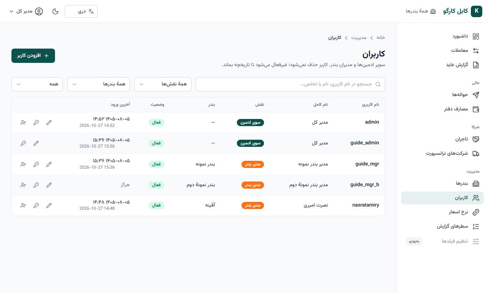
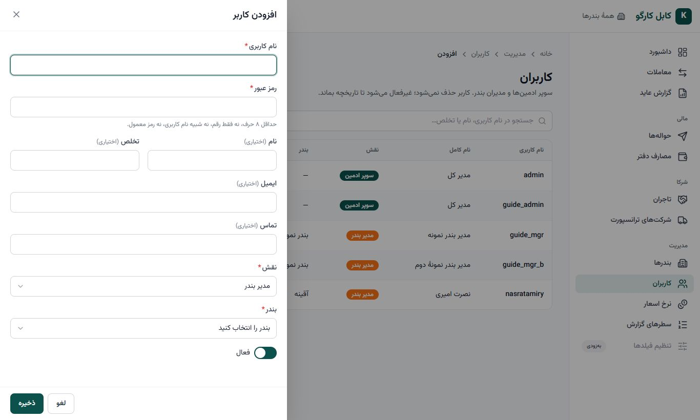

- **قفل:** کاربری که ۵ بار رمز اشتباه زده نشان «قفل» دارد → **باز کردن قفل**.
- **تغییر رمز:** برای کسی که رمزش را فراموش کرده.
- **غیرفعال کردن:** کارمندی که رفته — دیگر وارد نمی‌شود، اما سابقهٔ کارهایش می‌ماند.

## ۴. نرخ اسعار

**مدیریت → نرخ اسعار**: نرخ هر روز و هر ارز (دالر، کلدار، تومان …). نرخ تاریخ گذشته را هم
می‌توانید اضافه کنید؛ تاریخ آینده قبول نمی‌شود. تا ۸ رقم اعشار (برای ارزهای خیلی کوچک).
کلید **R** روی کیبورد هم فورم نرخ تازه را باز می‌کند.

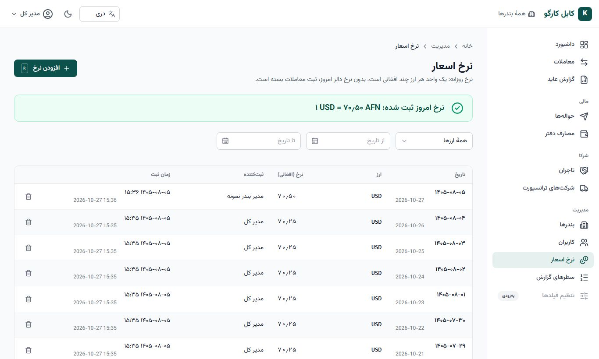

فقط سوپر ادمین نرخ را ویرایش یا حذف می‌کند.

## ۵. سطرهای گزارش

**مدیریت → سطرهای گزارش**: نام و ترتیب سطرهای گزارش عاید، و اینکه هر فیلد مصرف در کدام بخش
(هزینهٔ مستقیم، مصارف عملیاتی، سایر) بیاید. هر فیلد مصرف باید دقیقاً در یک سطر فعال باشد؛ اگر
نباشد، گزارش هشدار می‌دهد.

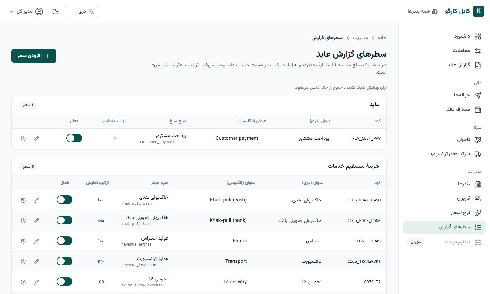

## ۶. تنظیم فیلدها

**مدیریت → تنظیم فیلدها**: بندر را انتخاب کنید و نوع معامله (واردات، صادرات، ترانزیت، تیر کارنت).
برای هر فیلد فورم معامله یکی را بزنید: **لازم**، **اختیاری** یا **مخفی**. با دکمه‌های ↑ ↓ (یا کشیدن
ردیف) ترتیب فیلدها را داخل هر بخش عوض کنید. پیش‌نمایش کنار جدول همان فورمی است که مدیر آن بندر
می‌بیند. تا **ذخیره** را نزنید، چیزی عوض نمی‌شود؛ نوار پایین شمار تغییرات ذخیره‌نشده را نشان می‌دهد.

- فیلدهای با قفل (شماره، تاریخ، پرداخت مشتری، نوع ارز، نرخ) همیشه لازم‌اند و عوض نمی‌شوند.
- اگر فیلدی را مخفی کنید که در معاملات قبلی مقدار دارد، شمار آن معاملات نشان داده می‌شود. داده‌ها
  پاک نمی‌شوند و در صفحهٔ جزئیات معامله دیده می‌شوند؛ فقط فورم آن را نشان نمی‌دهد.
- **کپی از بندر/نوع دیگر**، **کپی به همهٔ بندرها** و **بازگشت به پیش‌فرض** برای کار سریع. دکمهٔ
  ساعت کنار هر فیلد تاریخچهٔ تغییرات آن را نشان می‌دهد.

- فیلدهای عاید و مصرف اینجا نیستند؛ لینک بالای صفحه به **عواید و مصارف** می‌برد.

## ۶ب. عواید و مصارف

**مدیریت → عواید و مصارف** — یگانه جای تنظیم مبالغ معامله. سه تب: **عواید**، **مصارف**،
**کتگوری عواید دفتر**.

- **نوع تازه**: نام دری / پشتو / انگلیسی، برای مصرف بخش گزارش (هزینهٔ مستقیم، عملیاتی، سایر)، و جای آن
  در فورم. فوراً در همهٔ بندرها «اختیاری» اضافه می‌شود و در گزارش عاید سطر خودش را می‌گیرد.
- برای هر نوع: نام‌ها (✎)، ترتیب (↑ ↓ یا کشیدن)، **لازم / اختیاری / مخفی** برای بندر و نوع تجارت
  انتخاب‌شده (با «اعمال به همهٔ بندرها» / «اعمال به همهٔ انواع تجارت»)، فعال / غیرفعال، و
  **عاید شود / مصرف شود**. همه تا **ذخیره** فقط در پیش‌نمایش دیده می‌شوند.
- عاید یا مصرف بودن یک نوع فقط تا وقتی عوض می‌شود که هیچ معامله‌ای مبلغ آن را ندارد. «پرداخت مشتری»
  همیشه عاید و لازم است.
- غیرفعال کردن، نوع را از فورم برمی‌دارد ولی مبالغ قبلی در گزارش، جزئیات و Excel می‌مانند. حذف فقط
  برای نوع اضافه‌شده‌ای که هیچ مبلغی ندارد.

## ۷. پنل فنی Django

پنل فنی Django (تاریخچهٔ کامل تغییرات) در یک نشانی مخفی است که مسئول فنی هنگام نصب می‌سازد
(`https://transit.kabulcargo.com/<ADMIN_URL>`)؛ نشانی را در مدیر رمز نگه دارید و به کسی ندهید.
فقط سوپر ادمین وارد آن می‌شود. کار روزانه با همین صفحه‌های بالا انجام می‌شود؛ صفحه‌های
`/admin/...` در برنامه (بندرها، کاربران، نرخ‌ها …) همان صفحه‌های بالا هستند، نه پنل Django.

## ۸. بک‌اپ

سیستم هر شب خودکار بک‌اپ می‌گیرد. اینکه بک‌اپ‌ها بیرون از سرور هم کاپی می‌شوند و ماهی یک بار
آزمایش بازیابی، کار مسئول فنی است — `docs/DEPLOY_COOLIFY.md` بخش ۷.
